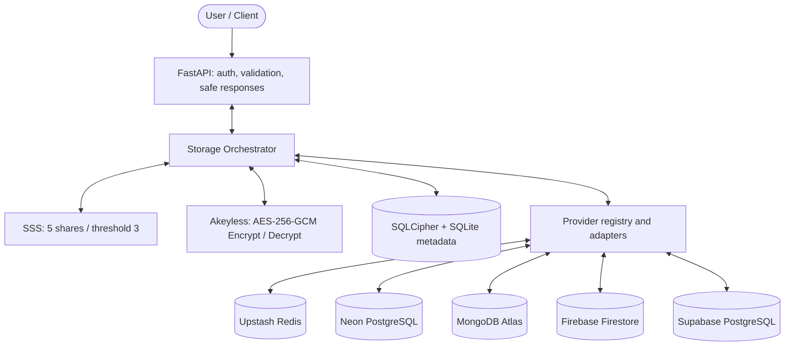
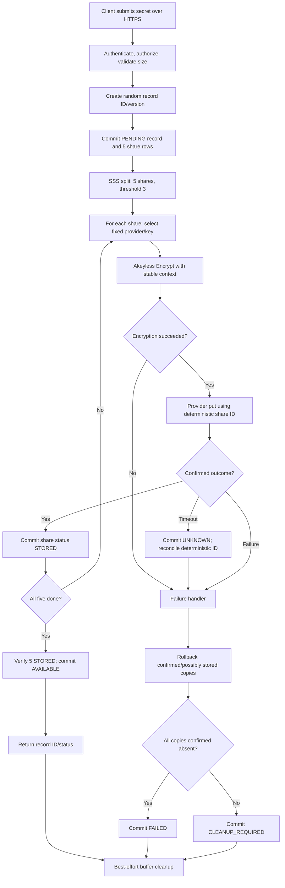
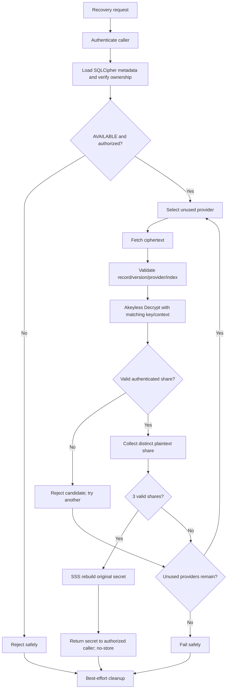
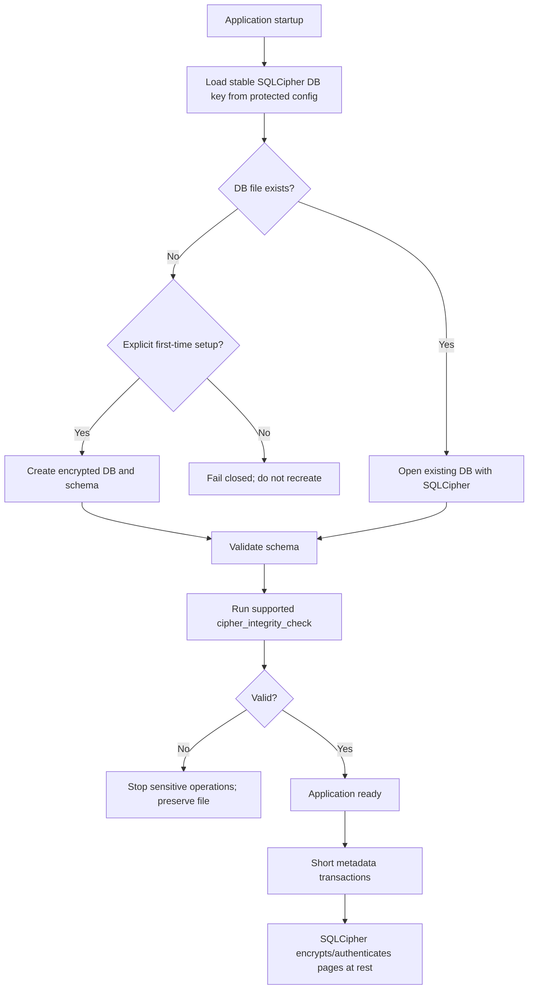

# Firefly Architecture

## 1. Component responsibilities

- **FastAPI (`app/api`)**: request/response models, authentication dependency, authorization, HTTP errors. No crypto orchestration in route handlers.
- **Storage Orchestrator (`app/services/orchestrator.py`)**: owns store/recover sequencing, state transitions, retry/rollback decisions, cleanup calls.
- **SSS service**: thin wrapper around a vetted library; config is fixed to 5 shares / threshold 3.
- **Akeyless service**: performs Encrypt/Decrypt operations, Base64 conversion and encryption-context construction. It never accepts a caller-provided arbitrary key name without checking the configured mapping.
- **Adapters**: one provider-specific implementation each, all with the same contract.
- **SQLCipher repository**: owns short transactions for record and share status. No network call from inside a DB transaction.

## 2. Locked provider/key mapping

| Provider ID | Store | Akeyless key reference |
|---|---|---|
| `upstash` | Upstash Redis | configured reference for share 1 |
| `neon` | Neon PostgreSQL | configured reference for share 2 |
| `mongodb` | MongoDB Atlas | configured reference for share 3 |
| `firebase` | Firebase Firestore | configured reference for share 4 |
| `supabase` | Supabase PostgreSQL | configured reference for share 5 |

Key names/references are configuration, not cryptographic key material. The registry validates the mapping. SQLite may persist the configured reference used for a record/version, but it must never contain the raw key or Akeyless credentials.

## 3. Provider adapter contract

Each adapter should expose a small equivalent of:

- `put_share(share_id, envelope) -> PutResult`
- `get_share(share_id) -> ShareEnvelope | None`
- `delete_share(share_id) -> DeleteResult`
- optional `health_check() -> HealthResult`

The exact interface should encode outcomes explicitly: confirmed success, confirmed absence/failure, or unknown outcome. Exceptions must be translated into safe adapter errors and must not include payloads or credentials in logs.

**Provider identity:** use deterministic IDs based only on random record ID, version and share index, for example `firefly:<record_id>:v<version>:share:<index>`. Never derive IDs from the secret itself.

**Stored payload:** store the Akeyless ciphertext exactly as returned, plus non-secret routing/format fields if needed. Treat Akeyless ciphertext as opaque; don't assume or invent a local nonce/tag layout. Use provider-native values (string, `BYTEA`, BSON document, Firestore fields). No TTL/expiration for stored shares.

## 4. Shared object contracts

`ShareEnvelope` logically contains:

- `record_id`
- `version`
- `share_index` (1–5)
- `provider_id`
- `key_ref` (reference only)
- `format_version`
- `ciphertext` (opaque Akeyless return value)

The record ID, version, index, provider ID and format version must be part of a stable Akeyless encryption context. Exactly the same context must be supplied at decryption. Before using a key reference read from metadata, compare it against the trusted provider registry.

## 5. Synchronous MVP

Use a synchronous implementation end-to-end initially: sync FastAPI route handlers, sync adapters/SDKs, and sync orchestration. This keeps error handling straightforward. Apply explicit connect/read/operation timeouts to external calls. Do not call synchronous network clients directly inside an `async def` handler. If async is introduced later, migrate the complete path consistently.

## 6. Four diagrams

### Diagram A — whole system

### Diagram B — store/distribute

### Diagram C — recovery

### Diagram D — SQLCipher lifecycle

## 7. Data flow notes

- Input secret is plaintext inside the trusted FastAPI/backend process in this agreed scope.
- SSS shares are plaintext in backend memory only until sent to Akeyless for encryption.
- Akeyless returns opaque ciphertext; each storage provider receives only its designated ciphertext.
- During recovery, Akeyless returns plaintext shares to the trusted backend; SSS reconstructs the original secret there.
- Python cleanup is best-effort. Never promise total memory erasure.
