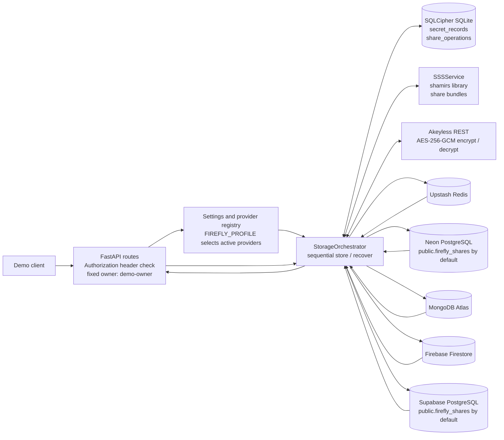
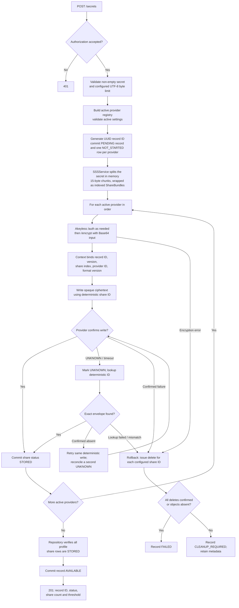
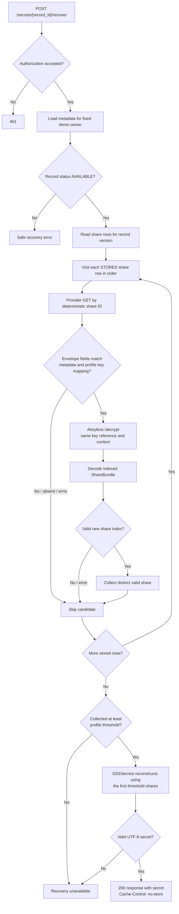

# Firefly: Implemented Architecture and Workflow

This document describes the behavior wired into the current Python code, not
the broader product plan.

## What runs with the current local configuration

The application reads `FIREFLY_PROFILE` from the repository-root `.env`. If it
is missing, the code defaults to `full`. The current local settings resolve to:

- Profile: `full`
- Shamir: 5 shares, threshold 3
- Providers: Upstash, Neon, MongoDB Atlas, Firestore, and Supabase

The code also supports `FIREFLY_PROFILE=three_provider`:

- Shamir: 3 shares, threshold 2
- Providers: Upstash, Neon, and Firestore
- MongoDB and Supabase settings are not required for this profile
- SQLCipher metadata uses a separate filename with `.three-provider` added

The three-provider live tests used a temporary process-level profile override;
they did not change `.env`. To make a normal local app launch use the reduced
profile, set `FIREFLY_PROFILE=three_provider` in `.env` and restart the app.
The reduced profile is intended for synthetic hackathon demos and is rejected
when `FIREFLY_ENV=production`.

## Component and data-flow diagram

In the `three_provider` profile, MongoDB and Supabase are not instantiated or
contacted. In `full`, all five providers are active. Provider index/key mapping
is assigned in the active profile's order:

| Profile | Share 1 | Share 2 | Share 3 | Share 4 | Share 5 |
|---|---|---|---|---|---|
| `full` (default) | Upstash | Neon | MongoDB | Firestore | Supabase |
| `three_provider` | Upstash | Neon | Firestore | — | — |

Each active provider uses its matching configured Akeyless key reference.

## Store workflow as implemented

Implementation details represented in the diagram:

- The pending metadata record and its share rows are committed before external
  encryption or provider writes. Network calls are not made inside that
  metadata transaction.
- Provider writes happen sequentially, not in parallel. There is no
  cross-provider transaction.
- `AVAILABLE` means all providers in the selected profile have confirmed
  writes and the metadata transition has committed.
- Share IDs are deterministic from the random record ID, version, and share
  index. Akeyless ciphertext is stored as an opaque value with routing metadata.
- On store failure, the orchestrator attempts deletes across the configured
  share rows. It records confirmed cleanup or `CLEANUP_REQUIRED`; cleanup is
  not guaranteed just because the request failed.

## Recovery workflow as implemented

The current recovery loop visits all stored candidates before checking the
threshold; it does not stop provider queries immediately when the threshold is
reached. It only supplies the first threshold number of distinct decoded
shares to reconstruction. A candidate is skipped if its envelope metadata
doesn't match, its provider read fails, Akeyless rejects decryption, or share
decoding/validation fails.

For `three_provider`, one valid share is insufficient and two distinct valid
shares are required. The negative live test retrieved/decrypted one synthetic
share, observed reconstruction rejection, and confirmed remote test share
cleanup.

## Metadata, providers, and API boundaries

### SQLCipher metadata

The encrypted local database contains two tables:

- `secret_records`: owner, version, profile share count/threshold, status, and
  timestamps.
- `share_operations`: share index, provider ID, deterministic share ID,
  Akeyless key reference, status, attempt count, and normalized error code.

The original secret, plaintext Shamir shares, and Akeyless key material are
not repository fields. Each profile gets a compatible schema check constraint;
the three-provider profile's database path is separate from the full
profile's path. The current repository initializes tables with
`CREATE TABLE IF NOT EXISTS`.

### Provider adapters

All adapters implement `put_share`, `get_share`, `delete_share`, and
`health_check`:

- Upstash uses REST `SET`/`GET`/`DEL`/`PING`; share writes set no TTL.
- Neon and Supabase use the shared psycopg adapter over TLS and configured
  schema/table identifiers.
- MongoDB uses deterministic document `_id` values.
- Firestore uses deterministic document IDs in the configured collection.

### API routes currently present

- `GET /health`: returns `{"status":"ok"}` without probing provider readiness.
- `POST /secrets`: authenticated store request.
- `POST /secrets/{record_id}/recover`: authenticated recovery; the returned
  secret response uses `Cache-Control: no-store` and `Pragma: no-cache`.
- `GET /secrets/{record_id}/status`: authenticated metadata status.

The demo auth dependency maps any valid configured bearer token to the single
hard-coded owner `demo-owner`; this is not multi-user identity management.
There is no public delete endpoint or automatic background reconciliation
worker. Delete operations are used internally for rollback.

## Demo-relevant boundaries

- Akeyless authentication/encrypt/decrypt and all provider operations are live
  network calls with configured timeouts.
- A timeout can leave the outcome unknown; the write path reconciles by the
  deterministic share ID before retrying.
- SQLCipher and provider test results are environment-specific. The
  three-provider end-to-end live test passed with a synthetic secret and
  verified remote deletion; the normal local profile currently resolves to
  `full`, so select `three_provider` in `.env` before launching a three-provider
  demo.
- Python memory cleanup is best-effort; complete zeroization is not claimed.
