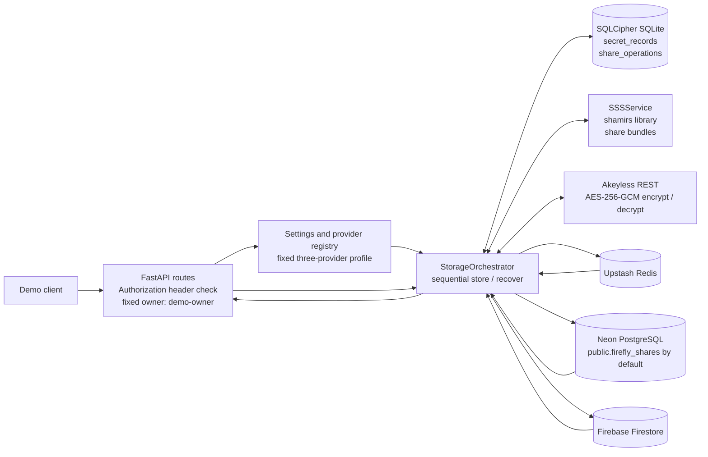
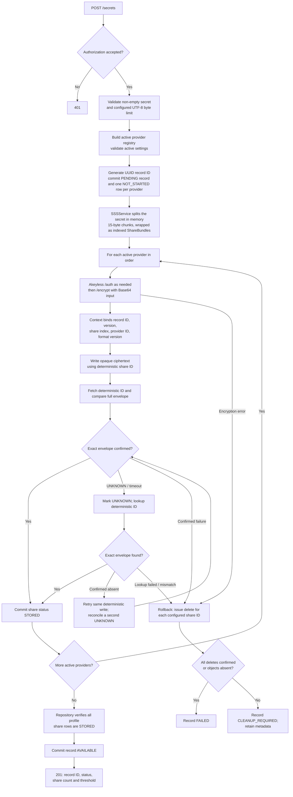
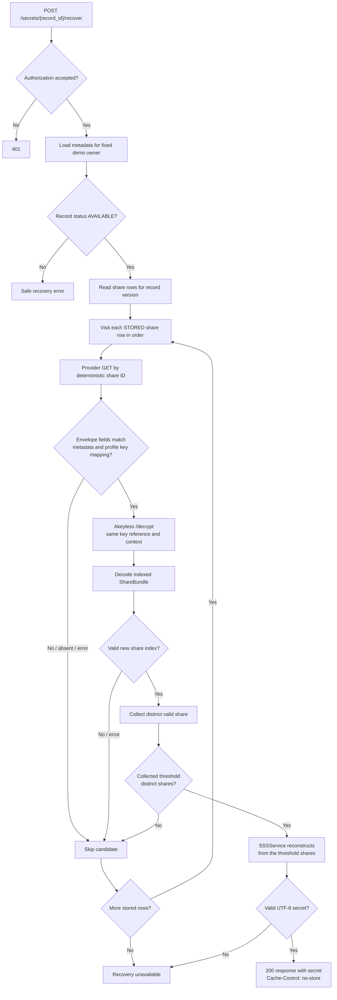

# Firefly: Implemented Architecture and Workflow

This document describes the behavior wired into the current Python code, not
the broader product plan.

## What runs with the current local configuration

The application accepts only `FIREFLY_PROFILE=three_provider`; if the variable
is missing, that profile is selected. It uses 3 shares / threshold 2 across
Upstash, Neon, and Firestore. Other profile values (including the old `full`)
are rejected. `FIREFLY_ENV=production` is also rejected because this demo's
authentication is not production identity management.

The configured SQLCipher path receives a `.three-provider` filename suffix.
This keeps the active metadata separate from any older five-provider database;
records are not migrated between files. On startup, a redacted log line shows
the selected profile, provider IDs, 3/2 threshold, and active metadata path.

## Component and data-flow diagram

Only Upstash, Neon, and Firestore are instantiated. Provider index/key mapping
is fixed: share 1 → Upstash, share 2 → Neon, and share 3 → Firestore. Each
provider uses its matching configured Akeyless key reference.

## Store workflow as implemented

Implementation details represented in the diagram:

- The pending metadata record and its share rows are committed before external
  encryption or provider writes. Network calls are not made inside that
  metadata transaction.
- Provider writes happen sequentially, not in parallel. Each write is read
  back by deterministic ID and compared with the complete expected envelope
  before its metadata row is marked `STORED`. There is no cross-provider
  transaction.
- `AVAILABLE` means all providers in the selected profile have confirmed
  writes and the metadata transition has committed.
- Share IDs are deterministic from the random record ID, version, and share
  index. Akeyless ciphertext is stored as an opaque value with routing metadata.
- A successful `put_share` response alone is insufficient to advance state.
  Missing or mismatched read-back fails the operation; read errors remain
  `UNKNOWN` and cannot lead to `AVAILABLE`.
- On store failure, the orchestrator attempts deletes across the configured
  share rows. It records confirmed cleanup or `CLEANUP_REQUIRED`; cleanup is
  not guaranteed just because the request failed.

## Recovery workflow as implemented

The recovery loop stops as soon as the threshold number of distinct valid
shares has been decrypted and validated, so with all providers healthy only two
are contacted. It moves on to the next provider only when a candidate is
skipped: its envelope metadata doesn't match, its provider read fails, Akeyless
rejects decryption, or share decoding/validation fails (including a decoded
index that differs from its metadata row). If the valid shares cannot be
combined, a controlled `RecoveryError` is raised rather than an unhandled
exception.

One valid share is insufficient and two distinct valid shares are required.
The negative live test retrieved/decrypted one synthetic share, observed
reconstruction rejection, and confirmed remote test share cleanup.

The internal `_recover_secret_from_provider_ids` helper supports the opt-in
`python -m scripts.verify_provider_pairs` live harness. It is not an API route.
The harness writes one synthetic record, checks all three two-provider
combinations through the real adapters and Akeyless, then confirms cleanup.
Provider outages are reported as `INCONCLUSIVE`.

## Startup and lifecycle

On startup the FastAPI lifespan, in order:

1. requires a non-blank `FIREFLY_API_TOKEN`;
2. builds the provider registry, Akeyless service, and the SQLCipher repository
   **once** (`app/services/factory.py`). The repository opens an existing
   database only: a missing file, wrong key, non-SQLCipher driver, missing
   schema, or failed `cipher_integrity_check` stops startup, and the file is never
   recreated. First-time creation is the explicit `python -m scripts.init_db`;
3. runs `reconcile_pending()` for records left `PENDING` or `CLEANUP_REQUIRED` by
   a crash (see `FAILURE_HANDLING.md` section 5);
4. serves requests using the shared orchestrator and, on shutdown, closes the
   adapters and the Akeyless session.

Share status `ENCRYPTED` is not part of the lifecycle. `attempt_count` counts
provider write attempts only.

## Metadata, providers, and API boundaries

### SQLCipher metadata

The active encrypted local database contains two tables:

- `secret_records`: owner, version, profile share count/threshold, status, and
  timestamps.
- `share_operations`: share index, provider ID, deterministic share ID,
  Akeyless key reference, status, attempt count, and normalized error code.

The original secret, plaintext Shamir shares, and Akeyless key material are
not repository fields. Schema constraints are fixed at 3 shares and threshold
2. The active database path has the `.three-provider` suffix, separate from a
legacy five-provider file; there is no data migration. Tables are created only by the explicit first-time initializer, never by
normal startup.

### Provider adapters

All adapters implement `put_share`, `get_share`, `delete_share`, and
`health_check`:

- Upstash uses REST `SET`/`GET`/`DEL`/`PING`; share writes set no TTL.
- Neon uses the psycopg adapter over TLS and configured schema/table
  identifiers.
- Firestore uses deterministic document IDs in the configured collection.

### API routes currently present

- `GET /health`: returns `{"status":"ok"}` without probing provider readiness.
- `POST /secrets`: authenticated store request.
- `POST /secrets/{record_id}/recover`: authenticated recovery; the returned
  secret response uses `Cache-Control: no-store` and `Pragma: no-cache`.
- `GET /secrets/{record_id}/status`: authenticated metadata status.

The demo auth dependency maps any valid configured bearer token to the single
hard-coded owner `demo-owner`; this is not multi-user identity management.
There is no public delete endpoint or automatic background reconciliation
worker. Delete operations are used internally for rollback.

## Demo-relevant boundaries

- Akeyless authentication/encrypt/decrypt and all provider operations are live
  network calls with configured timeouts.
- A timeout can leave the outcome unknown; the write path reconciles by the
  deterministic share ID before retrying.
- SQLCipher and provider test results are environment-specific. The
  three-provider end-to-end live test passed with a synthetic secret and
  verified remote deletion. The application defaults to and only accepts this
  profile. Startup logs show the profile, provider IDs, threshold, and active
  metadata path.   `python -m scripts.check_services` separately probes the three
  providers and Akeyless using synthetic data, without writing provider
  objects.
- The preflight is not performed by `/health`; run it before live demos, then
  verify complete store/recovery and cleanup with an end-to-end synthetic test.
- Recovery returns the plaintext secret. Never log, persist, screenshot, or
  share the response body.
- Python memory cleanup is best-effort; complete zeroization is not claimed.
